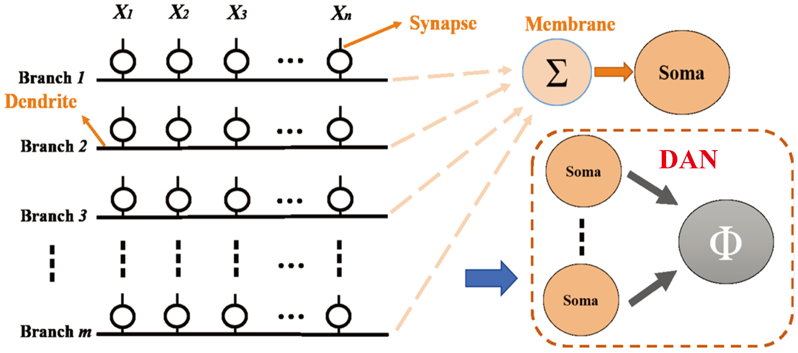

# Dendritic Attention Network for Solar Irradiance Forecasting

This is the official code repository for the paper: A Biologically Inspired Dendritic Attention Network for Short-Term Solar Irradiance Forecasting in Photovoltaic Systems.

In our paper, we introduce:

- **Dendritic attention network:** The network architecture of the model dendritic attention network (DAN).

- **Process flow:** The framework of forecasting future solar irradiance via the DAN.

## Software & Hardware Requirements

The implementation is based on Python and the required environmental dependencies are relatively simple. Version control tool is not necessary.
