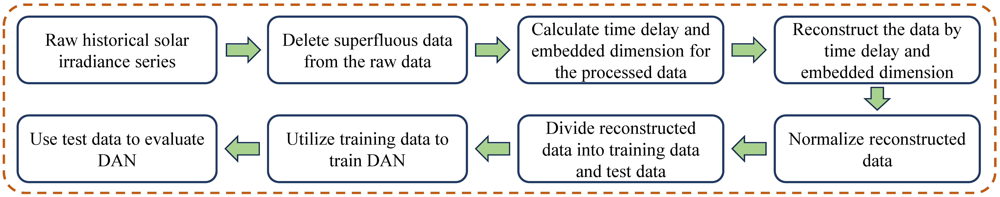

# Dendritic Attention Network for Solar Irradiance Forecasting

This is the official code repository for the paper: A Biologically Inspired Dendritic Attention Network for Short-Term Solar Irradiance Forecasting in Photovoltaic Applications.

In our paper, we introduce:

- **Dendritic attention network:** The network architecture of the model dendritic attention network (DAN).

<p align="center">

</p>

- **Process flow:** The framework of forecasting future solar irradiance via the DAN.

<p align="center">

</p>

## Software & Hardware Requirements

The implementation is based on Python and the required environmental dependencies are relatively simple. Version control tool is not necessary.

## Dataset description

### Data source

All six datasets were downloaded from the [National Solar Radiation Database](https://developer.nlr.gov/docs/solar/nsrdb/) using the [GOES Aggregated PSM v4 API](https://developer.nlr.gov/docs/solar/nsrdb/nsrdb-GOES-aggregated-v4-0-0-download/).

The downloaded files identify the source and version as:

```text
Source: NSRDB
Model version: 4.0.0
Year: 2022
Variable: GHI
Unit: W/m²
```

The GOES Aggregated product is a gridded, satellite-derived solar-resource dataset produced using the NSRDB Physical Solar Model. Its underlying product has an approximately 4-km spatial resolution and a native 30-minute temporal resolution. This repository requested the data at a 60-minute interval.

### Geographic information

Coordinates are expressed in decimal degrees using the usual WGS84 longitude/latitude convention. Negative longitude denotes west and negative latitude denotes south.

| Dataset | Representative country and city | Requested latitude | Requested longitude | Returned NSRDB latitude | Returned NSRDB longitude | NSRDB location ID | Local standard-time offset | Elevation |
|---|---|---:|---:|---:|---:|---:|---:|---:|
| Dataset1 | Havana, Cuba | 23.1136 | −82.3666 | 23.13 | −82.38 | 1012710 | UTC−05:00 | 10 m |
| Dataset2 | Mexico City, Mexico | 19.4326 | −99.1332 | 19.45 | −99.14 | 639946 | UTC−06:00 | 2,240 m |
| Dataset3 | Santa Cruz, Bolivia | −17.7833 | −63.1821 | −17.79 | −63.18 | 1581207 | UTC−04:00 | 421 m |
| Dataset4 | Paramaribo, Suriname | 5.8520 | −55.2038 | 5.85 | −55.22 | 1770917 | UTC−03:00 | 6 m |
| Dataset5 | Caracas, Venezuela | 10.4806 | −66.9036 | 10.49 | −66.90 | 1469456 | UTC−04:00 | 927 m |
| Dataset6 | Phoenix, United States | 33.4484 | −112.0740 | 33.45 | −112.06 | 323705 | UTC−07:00 | 334 m |

### Dataset files

```text
data/
├── dataset1_havana_2022.csv
├── dataset2_mexico_city_2022.csv
├── dataset3_santa_cruz_2022.csv
├── dataset4_paramaribo_2022.csv
├── dataset5_caracas_2022.csv
├── dataset6_phoenix_2022.csv
└── manifest.json
```

The original files are retained in NSRDB CSV format, including their metadata rows. The accompanying `manifest.json` records the requested city coordinates, download year, selected-window starting date, and sample counts.
